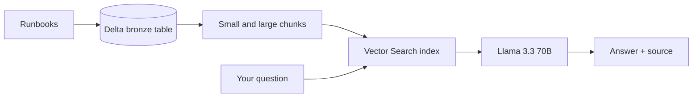

<div align="center">
👋 Hi, I'm Aarti Paliwal
Data Engineer | Azure and Databricks | GenAI
<a href="https://github.com/aartipaliwal">  </a> <br/>

Show Image Show Image

</div>
---

## 👩‍💻 Who am I?

```python
class Aarti:
    role       = "Software Engineer @ Accenture"
    experience = "~2 years on Azure Databricks data platforms"
    superpower = "Turning data into reliable pipelines and AI-powered apps"
    now        = ["Databricks Apps", "Databricks AI tools", "RAG and vector search", "Genie agents"]
    learning   = ["Agent Bricks", "Databricks Asset Bundles", "Agentic AI"]
    goal       = "Data / AI Engineer at a product-based company"

    def ask_me_about(self):
        return ["Databricks", "Delta Lake", "PySpark", "RAG basics"]
```

I'm a Software Engineer at Accenture with about 2 years of experience working on **Azure Databricks** ETL pipelines. Now I'm building with **Databricks Apps** and **Databricks AI tools**, and growing in the **data + AI** space through hands-on projects with RAG, vector search and agentic tools.

---

## 🚀 Featured project

<table>
<tr>
<td>

### 🚨 [Pipeline Incident Assistant](https://github.com/aartipaliwal/incident-assistant)
**RAG on Databricks:** ask about a failed pipeline, get the fix and the source runbook.

- 🔎 Semantic search with **Databricks Vector Search**
- 🧠 Answers grounded in runbooks by **Llama 3.3 70B**, with "I don't know" for anything out of scope
- ⚖️ Compared **small vs. large chunking** using a test set
- 🔄 **Incremental updates** re-process only changed runbooks
- ⏱️ Orchestrated with a **Databricks Job**

[](https://github.com/aartipaliwal/incident-assistant)

</td>
</tr>
</table>



---

## 🛠️ Other projects

### 🔹 Retail Sales Data Analysis
Processed and analyzed retail sales data with Spark DataFrames: null handling, deduplication, type casting, and joining datasets to calculate revenue metrics.


---

## 🧰 Tech stack


**GenAI:** RAG · Embeddings · Vector Search · LLM prompting · Evaluation

---

## 🗺️ My roadmap

| ✅ Done | 🔨 Now | 🔜 Next |
|---|---|---|
| Databricks Data Engineer Associate | Databricks Apps and AI tools, Genie agents | Second GenAI project |
| Azure AZ-104 and AZ-900 | Agent Bricks and RAG | Deployment and containers |
| RAG Incident Assistant | Databricks Asset Bundles | Product-company Data / AI role |

---

## 🏅 Certifications and education

- ✅ **Databricks Certified Data Engineer Associate**
- ✅ **Microsoft Azure Administrator (AZ-104)**
- ✅ **Microsoft Azure Fundamentals (AZ-900)**
- 🎓 MCA, Kurukshetra University · BCA, Kurukshetra University (GPA 8.9/10)

---

## 📫 Let's connect

<div align="center">

[](www.linkedin.com/in/
aarti-paliwal
)
[](mailto:aartipaliwal86@gmail.com)

*"Data is only as useful as what you build on top of it."*


</div>
